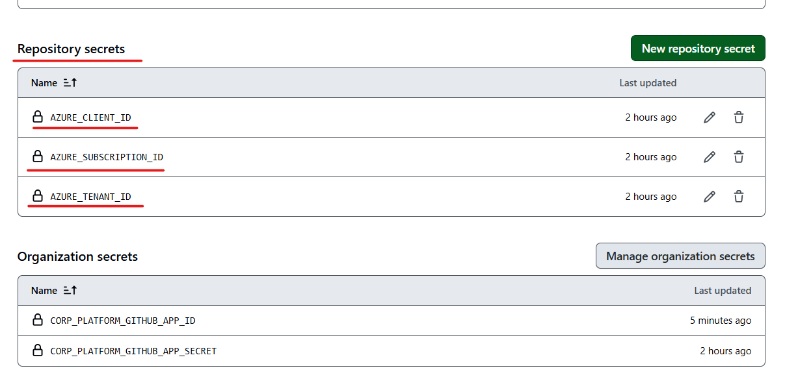
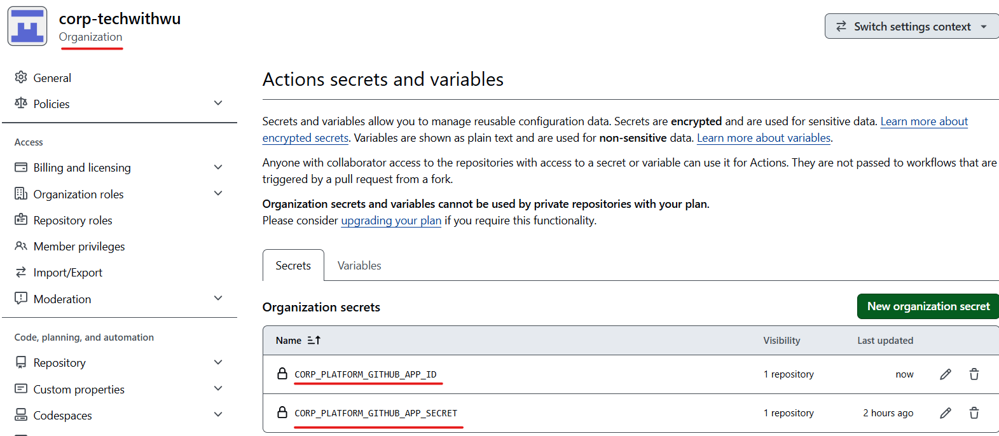

walk through:
Prerequisites:
* As GithubAsCode is designed for organization, so you need to create a Organization.
1. fork this repo "corp-platform-github" and push the code to your own organization.

2. Boostrap

Need to generate a subscription that is specially for this protect, as terraform need to store tfstate in the azure cloud.

replace the "org_name/repo_name" with your own organization and repo name.

execute the boostrap.ps1 script, then it will output the AZURE_CLIENT_ID, AZURE_TENANT_ID and AZURE_SUBSCRIPTION_ID.

==========================================
  Azure OIDC Credentials for GitHub Secrets
==========================================
AZURE_CLIENT_ID:       54fa05e6-238b-4c9d-a4be-39ec1a7a06dc
AZURE_TENANT_ID:       da528e4a-a122-4392-b5c8-370e74e0236d
AZURE_SUBSCRIPTION_ID: c5c80e22-450e-430a-b952-42a8b9307812
==========================================

Note: you need to generate your subscription manually if you are using personal subscription. take a look at the ./scripts/generatesubscription.ps1

Then you can run the create-terraform-storage-account-prod.yml to generate storage Account in the subscription

Then store AZURE_CLIENT_ID, AZURE_TENANT_ID, and AZURE_SUBSCRIPTION_ID to your repositories secrets

4. Execute Github Action protect-terraform-github-repo.yml, fill the paramters then will generate the storage Account for you.

5. Create a github app
create a github app, and install it in your organization.

store github app credentials in your organization level: CORP_PLATFORM_GITHUB_APP_ID, CORP_PLATFORM_GITHUB_APP_SECRET

6. checkout a new branch from main branch, make some change, then create PR to main branch.
